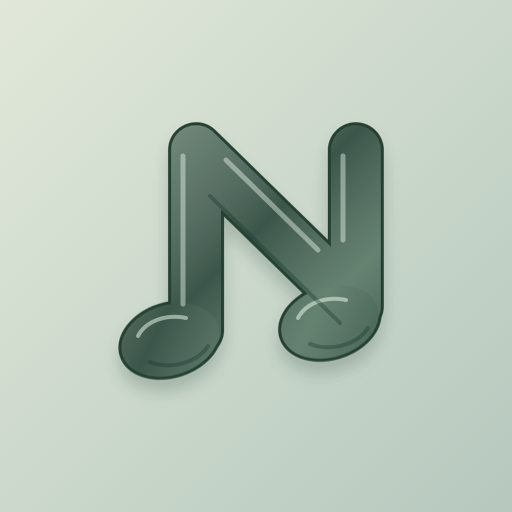
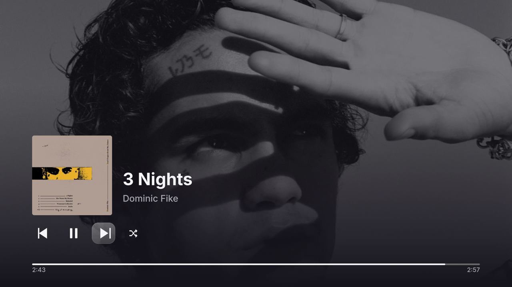
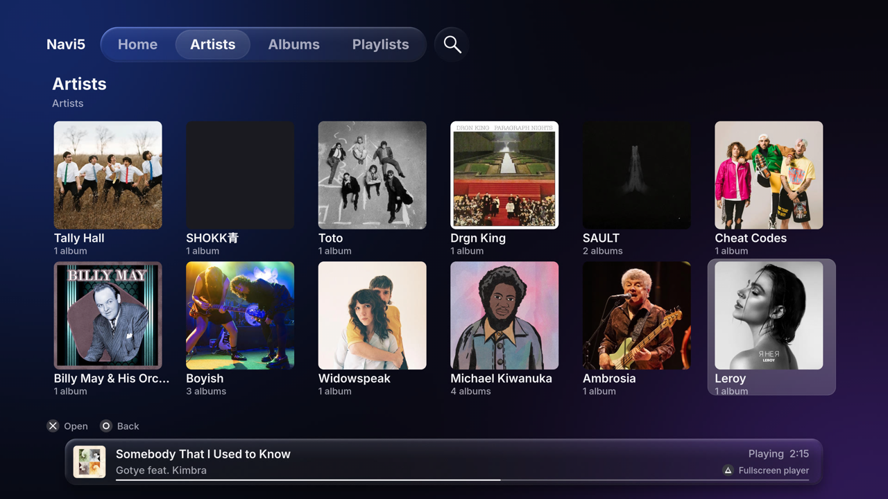
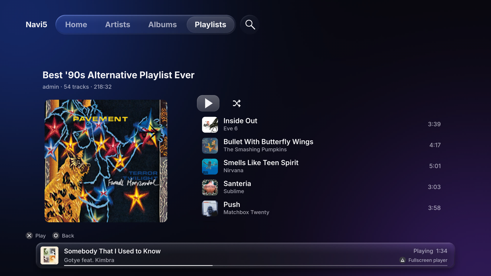

# Navi5

Navidrome/OpenSubsonic music client for use with a jailbroken PlayStation 5.

## Features

- Browse artists, albums, playlists, recently added albums and recently played.
- Find music with track, artist, album and playlist search previews.
- Play albums and playlists in order, with gapless playback, pause/resume,
  previous/next and Stop.
- Play Next for a track, album, playlist or artist, and a queue view to reorder
  or remove what is coming up.
- Listen to MP3, FLAC, AAC, M4A and Opus through native PS5 audio output.
- Connect from one login screen: type the server details on the left, or scan
  the QR code on the right; saved login reconnects on launch. Log out from the
  Options menu.

## Controls

| Button | Action |
| --- | --- |
| D-pad / Cross | Navigate / select or play |
| Circle | Back; leave the fullscreen player without stopping playback |
| L1 / R1 | Previous / next view (Home, Artists, Albums, Playlists, Search) |
| Triangle | Play Next: the focused track, album, playlist or artist plays after the current track |
| Touchpad | Open the fullscreen player |
| Square | Pause / resume; backspace in Search; remove in the queue view |
| Options | Menu: Log out (also the gear at the far right of the header) |

In the fullscreen player the control row has previous, play/pause, next, shuffle,
Stop and Queue; Down moves to the seek bar (Left / Right in 10-second steps,
Cross to apply). In the queue view, Cross picks up an upcoming track, Up / Down
moves it and Cross drops it; Square removes it. The current track stays put.

## Screenshots

### Fullscreen player

### Artists

### Playlist

## Roadmap

Ideas; scope may change:

- QR party mode for guest song requests.
- Investigate radio mixes and dynamic playlists.
- DualSense touchpad typing.

## Getting started

Navi5 needs a jailbroken PS5, a compatible native-homebrew loader such as
ShadowMountPlus, and a reachable Navidrome/OpenSubsonic server. A stock PS5 cannot run it.

For source builds, tests and private development setup, see
[Development](docs/DEVELOPMENT.md).

## Security

QR pairing currently uses unencrypted HTTP on your local network. Use only a trusted LAN.

Saved login is stored unencrypted on the console. When your Navidrome server supports API keys (not yet in a stable release as of v0.64.2), Navi5 creates its own revocable key, shown in Navidrome as the player "Navi5 (PS5)", and saves that instead of your password. On other servers the password is saved. Logging out deletes the saved login from the console but cannot revoke the key: delete that player in Navidrome to revoke the console's access.

## Reports

Please report bugs and request features through GitHub Issues. Development happens
in a self-hosted repository that GitHub mirrors, so pull requests opened here are
brought over by hand.

## Credits and license

Navi5 is a modified fork of [02dnot/Jelly5](https://github.com/02dnot/Jelly5),
with work from [SymphonyStation5](https://github.com/TsvetomirGT/SymphonyStation5),
[Nuvio PS5](THIRD_PARTY_NOTICES.md#unavailable-upstream-locations),
[EVO Player](https://github.com/sainsaji/EVO-PLAYER-PS5) and
[ps5-native-app-boilerplate](THIRD_PARTY_NOTICES.md#unavailable-upstream-locations).
Original copyright and license notices are retained. Nuvio PS5 and boilerplate's
recorded upstream locations are currently unavailable; see linked provenance notes.

**GPL-3.0-or-later**; bundled components retain their own licenses. See
[LICENSE](LICENSE), [upstream credits and third-party notices](THIRD_PARTY_NOTICES.md),
[bundled license texts](app/licenses/README.md) and [corresponding source](docs/SOURCE.md).
[Provisional icon and artwork provenance](app/assets/branding/README.md).

Unofficial homebrew; no affiliation with or endorsement by Sony, Navidrome,
Subsonic or upstream projects. No warranty. Use only media you have the right to play.
