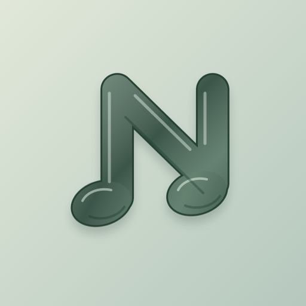
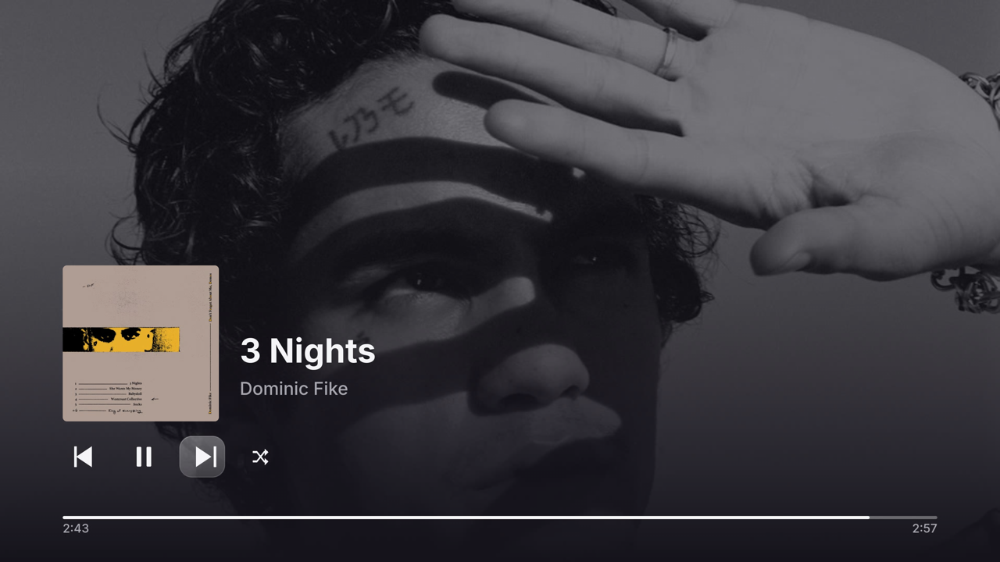
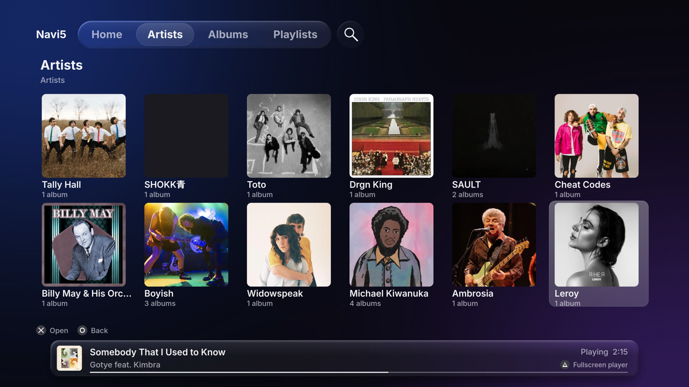
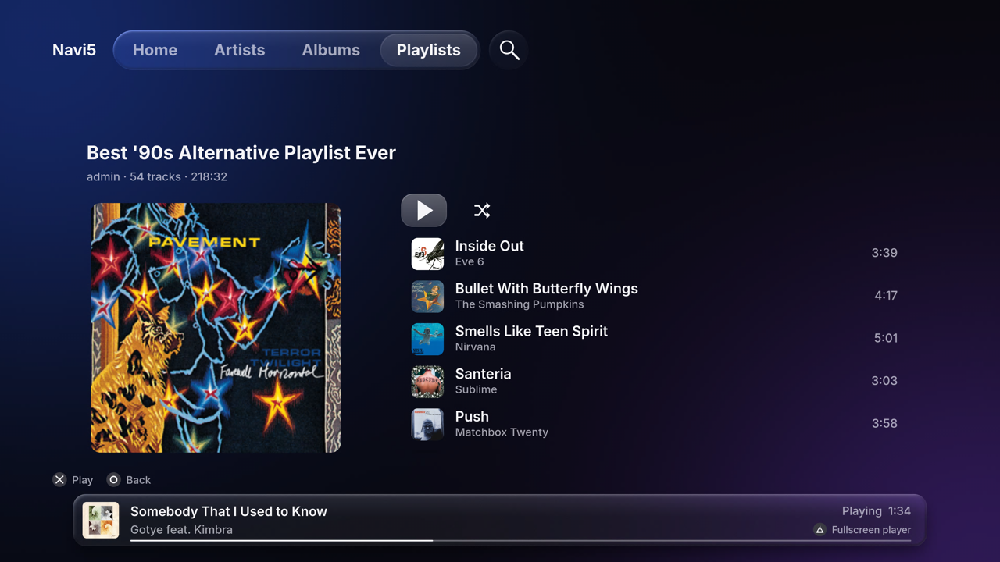

# Navi5

Navidrome/OpenSubsonic music client for use with a jailbroken PlayStation 5.

## Features

- Browse artists, albums, playlists, recently added albums and recently played.
- Find music with track, artist, album and playlist search previews.
- Play albums and playlists in order, with gapless playback, pause/resume,
  previous/next and Stop.
- Listen to MP3, FLAC, AAC, M4A and Opus through native PS5 audio output.
- Connect with manual login or LAN QR pairing; saved login reconnects
  on launch.

## Screenshots

### Fullscreen player

### Artists

### Playlist

## Roadmap

Post-beta ideas; scope may change:

- QR party mode for guest song requests.
- Playback queue and Play Next.
- Investigate radio mixes and dynamic playlists.
- DualSense touchpad typing.

## Getting started

Navi5 needs a jailbroken PS5, a compatible native-homebrew loader such as
ShadowMountPlus, and a reachable Navidrome/OpenSubsonic server. A stock PS5 cannot run it.

For source builds, tests and private development setup, see
[Development](docs/DEVELOPMENT.md).

## Security

QR pairing currently uses unencrypted HTTP on your local network. Use only a trusted LAN.

For now, password login stores your password unencrypted on the console. Persistent API-key login is planned for a future release to avoid saving your navidrome account password.

## Reports

Please report bugs and request features through GitHub Issues.

## Credits and license

Navi5 is a modified fork of [02dnot/Jelly5](https://github.com/02dnot/Jelly5),
with work from [SymphonyStation5](https://github.com/TsvetomirGT/SymphonyStation5),
[Nuvio PS5](THIRD_PARTY_NOTICES.md#unavailable-upstream-locations),
[EVO Player](https://github.com/sainsaji/EVO-PLAYER-PS5) and
[ps5-native-app-boilerplate](THIRD_PARTY_NOTICES.md#unavailable-upstream-locations).
Original copyright and license notices are retained. Nuvio PS5 and boilerplate's
recorded upstream locations are currently unavailable; see linked provenance notes.

**GPL-3.0-or-later**; bundled components retain their own licenses. See
[LICENSE](LICENSE), [upstream credits and third-party notices](THIRD_PARTY_NOTICES.md),
[bundled license texts](app/licenses/README.md) and [corresponding source](docs/SOURCE.md).
[Provisional icon and artwork provenance](app/assets/branding/README.md).

Unofficial homebrew; no affiliation with or endorsement by Sony, Navidrome,
Subsonic or upstream projects. No warranty. Use only media you have the right to play.
